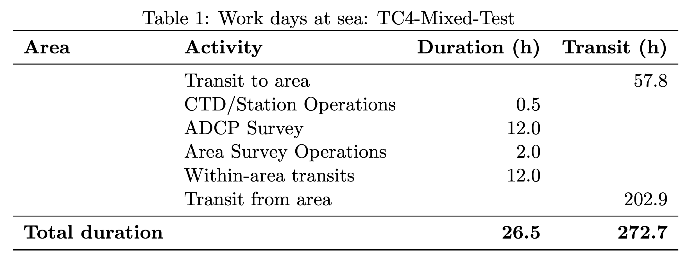
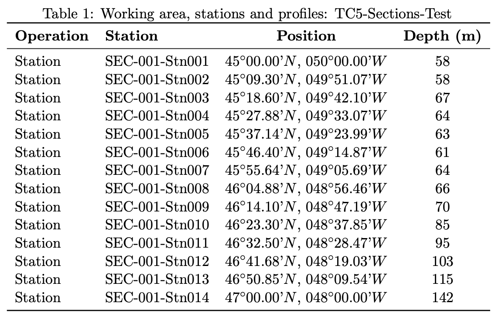

.. _output-latex:

============
LaTeX Output
============

LaTeX format generates tables specifically designed for DFG-style cruise proposals, including when complete station lists are requested with latitude and longitude positions.  It enables generation of these tables while minimizing the potential for user error.

.. note::
   LaTeX output is available from the **schedule command** (``cruiseplan schedule --format latex``). For configuration-based visualization, use :doc:`png` output via the map command.

Purpose and Use Cases
======================

**Primary Uses**:
  - DFG (German Research Foundation) cruise proposals

LaTeX Table Structure
=====================

Generated LaTeX files contain multiple specialized tables:

**1. Work Days at Sea Table**
  - Work activities and totals in hours
  - Separate column for transit time to/from the working area
  - Total sum of the duration in hours

**2. Station List Table**
  - Complete station catalog with coordinates (points and lines, but not areas)

Working Areas and Profiles
---------------------------

The LaTeX output includes a working areas table following DFG cruise proposal expectations.  It is wrapped in some basic latex code for standalone compilation.

.. code-block:: latex

    \begin{table}[htbp]
    \caption{Work days at sea: TC4-Mixed-Test}
    \centering
    \begin{tabular}{llrr}
    \toprule
    \textbf{Area} & \textbf{Activity} & \textbf{Duration (h)} & \textbf{Transit (h)} \\
    \midrule
    & Transit to area &  & 57.8 \\
    & Ctd Operations & 0.5 &  \\
    & Scientific Surveys & 12.0 &  \\
    & Area Survey Operations & 2.0 &  \\
    & Within-area transits & 9.6 &  \\
    & Transit from area &  & 200.7 \\
    \midrule
    \textbf{Total duration} & & \textbf{24.2} & \textbf{258.5} \\
    \bottomrule
    \end{tabular}
    \end{table}

   Example LaTeX work days at sea table from ``tc4_mixed_ops.yaml``, showing the professional DFG-style formatting with transit time, operational activities, and total sea days calculation.

Station List Format
--------------------

Note that the jinja template will break long tables across multiple ``tabular`` elements as needed.  The maximum number of rows is hard-coded at the moment in ``latex_generator.py`` as ``MAX_ROWS_PER_PAGE = 45``.

   Example LaTeX stations table from ``tc4_mixed_ops.yaml``, demonstrating the comprehensive station listing format including areas, scientific transits, and traditional station operations with precise coordinate and timing information.

.. code-block:: latex

    \begin{table}[htbp]
    \caption{Working area, stations and profiles: TC5-Sections-Test}
    \centering
    \begin{tabular}{llcc}
    \toprule
    \textbf{Operation} & \textbf{Station} & \textbf{Position} & \textbf{Depth (m)} \\
    \midrule
    Station & SEC-001-Stn001 & 45$^\circ$00.00'N, 050$^\circ$00.00'W & 58 \\
    Station & SEC-001-Stn002 & 45$^\circ$09.30'N, 049$^\circ$51.07'W & 58 \\
    Station & SEC-001-Stn003 & 45$^\circ$18.60'N, 049$^\circ$42.10'W & 67 \\
    Station & SEC-001-Stn004 & 45$^\circ$27.88'N, 049$^\circ$33.07'W & 64 \\
    Station & SEC-001-Stn005 & 45$^\circ$37.14'N, 049$^\circ$23.99'W & 63 \\
    Station & SEC-001-Stn006 & 45$^\circ$46.40'N, 049$^\circ$14.87'W & 61 \\
    Station & SEC-001-Stn007 & 45$^\circ$55.64'N, 049$^\circ$05.69'W & 64 \\
    Station & SEC-001-Stn008 & 46$^\circ$04.88'N, 048$^\circ$56.46'W & 66 \\
    Station & SEC-001-Stn009 & 46$^\circ$14.10'N, 048$^\circ$47.19'W & 70 \\
    Station & SEC-001-Stn010 & 46$^\circ$23.30'N, 048$^\circ$37.85'W & 85 \\
    Station & SEC-001-Stn011 & 46$^\circ$32.50'N, 048$^\circ$28.47'W & 95 \\
    Station & SEC-001-Stn012 & 46$^\circ$41.68'N, 048$^\circ$19.03'W & 103 \\
    Station & SEC-001-Stn013 & 46$^\circ$50.85'N, 048$^\circ$09.54'W & 115 \\
    Station & SEC-001-Stn014 & 47$^\circ$00.00'N, 048$^\circ$00.00'W & 142 \\
    \bottomrule
    \end{tabular}
    \end{table}

Professional Formatting
========================

**Typography**:
  - Proper mathematical typesetting
  - Consistent spacing and alignment
  - Professional table formatting

**Table Design**:
  - Clear column headers and separators
  - Proper use of horizontal rules
  - Consistent number formatting and units

**Document Integration**:
  - Standard LaTeX packages and dependencies
  - Compatible with common document classes
  - Proper figure and table referencing
  - Cross-reference support

Integration with Proposal Documents
------------------------------------

The schedule command writes two files: ``{cruise_name}_work_days.tex`` and
``{cruise_name}_stations.tex``.

**Standalone Compilation**:

.. code-block:: bash

   # Each file is a complete document (\documentclass ... \end{document})
   pdflatex {cruise_name}_work_days.tex
   pdflatex {cruise_name}_stations.tex

**Inclusion in Main Documents**:

Because each file is a standalone document, it cannot be ``\input`` directly.
Copy the ``table`` environment(s) from the generated file into the proposal.
The generated tables carry no ``\label``; add one after ``\caption`` if you
need to reference them with ``\ref``.

The LaTeX output format ensures that CruisePlan generates tables (especially station lists) that can be included in research cruise proposals.